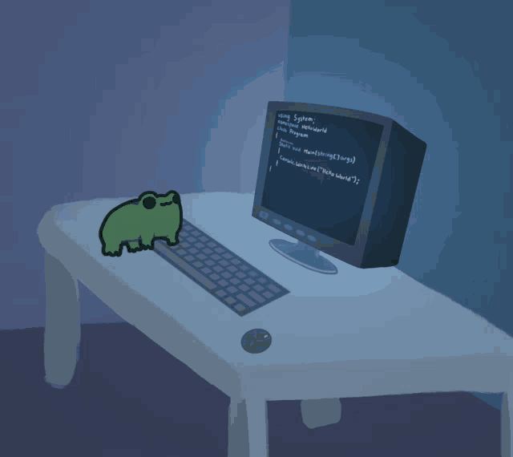
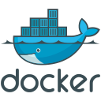

# Hi, I'm Artem 👋

### .NET Backend Developer

**C# · .NET 10 · ASP.NET Core · PostgreSQL · Apache Kafka · gRPC · Computer Vision**

---

## About

Backend developer in **C#/.NET**. Currently at an industrial company:

- computer-vision analytics over live camera streams (detection, tracking, face recognition, vector search)
- plugins extending a PLM/CAD platform
- a service that parses equipment logs and generates documentation

Also interested in distributed systems — messaging, gRPC and reliable delivery — and I keep a few
small Go tools on the side.

---

## Tech Stack

### Languages & Platform

&nbsp;&nbsp;&nbsp;&nbsp;&nbsp;&nbsp;

.NET 10 · ASP.NET Core · C# · Java · Go

### Backend & Integration

&nbsp;&nbsp;&nbsp;&nbsp;<a href="https://kafka.apache.org/"><picture>
  <source media="(prefers-color-scheme: dark)" srcset="https://raw.githubusercontent.com/kapitonov646/kapitonov646/main/assets/kafka-dark.svg" height="70" />
  
</picture></a>

Entity Framework Core · REST API · WebSockets · Spring Boot

### Data & Storage

&nbsp;&nbsp;&nbsp;&nbsp;

PostgreSQL · MongoDB · Redis · Milvus · MinIO

### Tooling & AI Vision

&nbsp;&nbsp;&nbsp;&nbsp;

Docker · Git · ONNX Runtime · OpenCvSharp · YOLO · ByteTrack · ArcFace · FFmpeg

---

### Let's connect

Always open to interesting backend and distributed-systems challenges.

